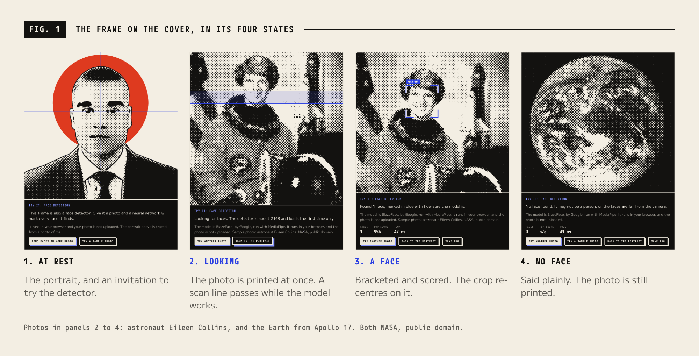
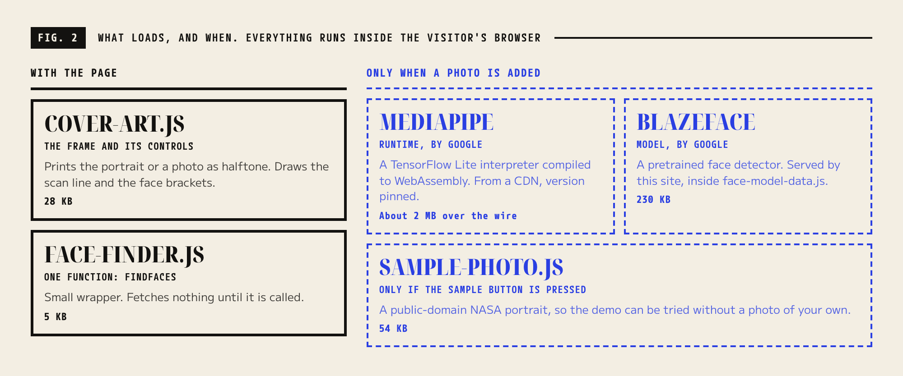
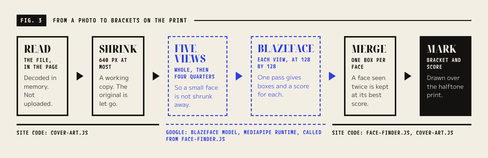
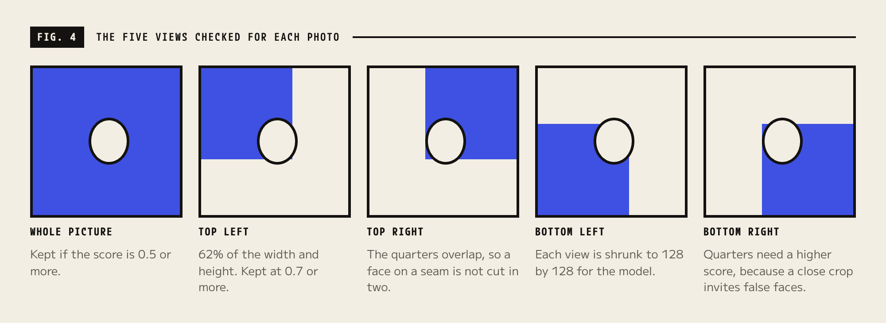
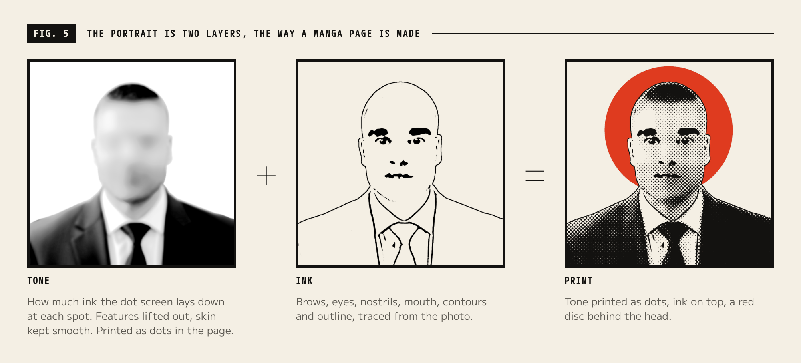

# Face detection in the browser, on a static site

*How the face detector on this site's cover works: what runs, where it runs, how BlazeFace and MediaPipe fit together, and what was tried along the way.*


The framed portrait on the cover is also a working demo. Give it a photo and a neural network finds the faces in it, brackets each one, and reports how sure it is.

There is no server behind this. The site is static HTML, CSS and JavaScript, so the model runs inside the visitor's browser and the photo never leaves their device.

## The short version

- **The model is BlazeFace**, a small face detector trained by Google. It was not trained for this site.
- **The runtime is MediaPipe**, which runs the model in the browser through WebAssembly.
- **Nothing is downloaded until a photo is added.** A visitor who only reads the page pays nothing for the feature.
- **The photo stays on the device.** It is read in the page, shrunk, checked and printed. It is never uploaded.
- **It detects faces. It does not recognise people.** It answers "is there a face here, and where", never "whose face is this".
- **The site's own code** does everything around the model: loading it lazily, scanning the photo in five overlapping views, merging the results, and printing the photo as halftone with the faces marked.

## Why a neural network can run in a browser at all

It sounds like it should need a server. It does not, for four reasons.

**1. Running a model is only arithmetic.** A trained neural network is a fixed list of numbers. Using it means multiplying arrays, adding, applying a simple function, and repeating that layer by layer. Any device that can do arithmetic can do it. Nothing about it needs a server or a graphics card.

**2. The expensive part was done in advance.** Training is what takes the large computers and the large datasets. Google did that for BlazeFace. A visitor's browser only *runs* the finished model, once per photo. This step is called inference.

**3. This model is tiny.** BlazeFace is 230 KB, smaller than most photos. That is what makes it reasonable to send to a browser. The models behind chat assistants are measured in gigabytes, thousands of times larger, which is why those still run on servers.

**4. WebAssembly makes it fast.** The runtime is compiled code, not plain JavaScript, and the model looks at a picture of only 128 x 128 pixels. Together that puts one detection at 30 to 50 thousandths of a second on a laptop.

What follows from running it this way:

| | In the browser, as here | On a server |
| --- | --- | --- |
| **The photo** | Never leaves the device | Has to be uploaded |
| **Cost to run** | Nothing, however many people try it | Grows with every request |
| **Works on a static site** | Yes | No, it needs a backend |
| **Model size** | Must be small enough to download | Can be as large as needed |
| **Speed** | Depends on the visitor's device | The same for everyone |

The choice depends on the job. A demo that checks one photo suits the browser. Matching a face against thousands of stored photos, as in the Plandaro pipeline described in Chapter 01 of the site, needs a database and a larger model, so that work belongs on a server.

## Contents

1. [What you see](#1-what-you-see)
2. [What loads, and when](#2-what-loads-and-when)
3. [BlazeFace: the model](#3-blazeface-the-model)
4. [MediaPipe: the runtime](#4-mediapipe-the-runtime)
5. [Loading them on a static site](#5-loading-them-on-a-static-site)
6. [From a photo to brackets](#6-from-a-photo-to-brackets)
7. [Sure rather than thorough](#7-sure-rather-than-thorough)
8. [Printing as halftone](#8-printing-as-halftone)
9. [The portrait: ink and tone](#9-the-portrait-ink-and-tone)
10. [Privacy and what is downloaded](#10-privacy-and-what-is-downloaded)
11. [How it was built, and what was tried](#11-how-it-was-built-and-what-was-tried)
12. [Limits](#12-limits)
13. [File map](#13-file-map)
14. [The other demo: vector search](#14-the-other-demo-vector-search)
15. [References](#15-references)

---

## 1. What you see

Under the frame, a caption says what it will do before anyone clicks: "This frame is also a face detector. Give it a photo and a neural network will mark every face it finds."

There are two ways in:

| Button | What it does |
| --- | --- |
| **Find faces in your photo** | Opens a file picker. Dropping a photo on the frame works too |
| **Try a sample photo** | Loads a public-domain NASA portrait, so the demo can be tried in one click |



Once the detector has answered, three numbers appear under the caption:

| Readout | Meaning |
| --- | --- |
| **Faces** | How many were found |
| **Top score** | The model's confidence in its surest face |
| **Took** | How long the detector took, download included on the first run |

"Back to the portrait" restores the frame. "Save PNG" exports the print with its brackets.

## 2. What loads, and when



The page itself carries only the frame's own code and a 5 KB wrapper. The model and its runtime, about 2.3 MB together, are fetched the first time a photo is added and cached by the browser after that.

## 3. BlazeFace: the model

BlazeFace is a small convolutional neural network published by Google in 2019. It was designed to find faces on phones in under a millisecond per frame, which is why it is small enough to send to a browser.

How it works, briefly:

- **It looks at a small picture.** Whatever it is given is first shrunk to 128 x 128 pixels.
- **It is a single-shot detector.** One pass over that picture produces a set of candidate boxes, each with a score between 0 and 1.
- **Overlapping candidates are merged**, so each face ends up with one box.
- **The score is the model's confidence** that the box holds a face. It is not a probability that has been checked against anything, and it can be wrong.

The version used here is the short-range one, built for faces fairly close to the camera, in the style of a selfie or a portrait. The file is 230 KB.

> **Detection is not recognition.** BlazeFace has no idea who anyone is. It cannot compare two faces or name one. The face *matching* described in Chapter 01 of the site (the Plandaro pipeline) is a different kind of model, and it is described there, not run.

## 4. MediaPipe: the runtime

BlazeFace is distributed as a TensorFlow Lite file. A browser cannot run that by itself.

MediaPipe's Tasks Vision package supplies the missing parts:

- **A TensorFlow Lite interpreter compiled to WebAssembly**, which executes the model on the CPU.
- **The processing around the model:** resizing the input, decoding the model's raw output into boxes, and merging overlaps.
- **A small JavaScript API**, `FaceDetector`, that takes an image or canvas and returns boxes with scores.

Both BlazeFace and MediaPipe are open source under the Apache License 2.0. The site credits them in its contact section.

## 5. Loading them on a static site

**Source:** [`js/face-finder.js`](js/face-finder.js). It exposes one function:

```js
LJ.findFaces(canvas)   // -> Promise of [{ x, y, w, h, score }, ...]
```

Nothing is fetched until that function is first called. Then two things load side by side:

| Piece | Comes from | Size |
| --- | --- | --- |
| MediaPipe Tasks Vision 0.10.14 | The jsDelivr CDN, version pinned | About 2 MB over the wire |
| BlazeFace, short range, float16 | This site: [`js/face-model-data.js`](js/face-model-data.js) | 230 KB model, 307 KB as base64 |

### Why the model lives inside a script

The model is the unmodified `.tflite` file, base64-encoded in a JavaScript file. That looks odd, and it is deliberate.

The obvious way to load a binary file is `fetch`. That fails when a site is opened straight from disk, because browsers block it there. A script tag is not blocked. Keeping the model in a script means the demo works the same from a folder on a laptop as it does on a web server.

The bytes are decoded and handed to MediaPipe as a buffer:

```js
vision.FaceDetector.createFromOptions(files, {
  baseOptions: { modelAssetBuffer: modelBytes(), delegate: 'CPU' },
  runningMode: 'IMAGE',
  minDetectionConfidence: 0.5
});
```

The sample photo is stored the same way, for a related reason: a picture loaded from disk cannot be read back from a canvas, and one loaded from data can.

### Speed

- The first detection includes starting the runtime. With the files cached it takes about a third of a second.
- After that, a detection takes 30 to 50 ms on a laptop.
- A failed load is not remembered, so a later attempt can try again.

## 6. From a photo to brackets

**Sources:** [`js/cover-art.js`](js/cover-art.js) and [`js/face-finder.js`](js/face-finder.js).



1. **Read.** The file is decoded in the page.
2. **Shrink.** A working copy at most 640 px on its long side is kept, flattened onto white. The original is released.
3. **Print and scan.** The photo is printed as halftone straight away, and a scan line passes down the frame while the detector works.
4. **Detect.** The working copy is checked in five views (below).
5. **Merge.** A face seen in more than one view is kept once, at its highest score.
6. **Mark.** The crop re-centres on the faces, and each gets a blue bracket and a tag such as "FACE 95%".

Two small timing decisions:

- **The scan is held for at least 0.9 seconds.** Once loaded, the detector answers in a few hundredths of a second, which is too fast to see. The short hold lets the answer be seen to arrive.
- **The page gives up after 20 seconds.** If the runtime cannot be fetched, the caption says so and the photo stays printed without a result.

### Looking more than once

Because the model works on a 128 x 128 copy, a face that is small in the photo can be shrunk to nothing. So each photo is checked five times.



## 7. Sure rather than thorough

The five-view scan is a deliberate trade, and it was settled by experiment.

Cutting the photo into finer tiles (4 x 4, then 5 x 5) does find the small faces of a distant crowd. In testing, it also began to report faces in a photo of a cat and in a mountain landscape.

For a demo whose whole point is to say "this is a person" or "this is not", a false face is the worse mistake. So the coarse scan stayed, and the quarters need a higher score (0.7) than the whole picture (0.5).

| Test picture | Result |
| --- | --- |
| Four single portraits | 1 face each, scores 0.81 to 0.98 |
| Four people in one picture | 4 faces, scores 0.89 to 0.93 |
| A cat, a dog, a mountain landscape, the Earth | No face |
| A group photo of 29 people, each face about 20 px | No face. Missed, by the trade above |

The caption is honest about that last case: "No face found. It may not be a person, or the faces are far from the camera."

## 8. Printing as halftone

**Source:** [`js/cover-art.js`](js/cover-art.js).

The photo is not shown as pixels. It is printed the way a manga page is: as a screen of dots, where a darker tone is a bigger dot. This is ordinary image processing, not machine learning.

- The dots sit on a lattice turned 45 degrees, the classic screentone angle, about 82 dots across the frame.
- Each dot takes its size from the brightness of the photo at that spot.
- Dot radius follows the square root of the tone, so the dot's *area* is what tracks darkness. That is what the eye reads.
- Contrast is stretched between the 2nd and 98th percentiles, so a dim photo still prints with real blacks.
- Very light tones print as bare paper, which keeps stray specks off areas that should be white.

Hovering the frame shows a loupe and the ink percentage at that spot.

The frame always prints black ink on cream paper, in both the day and night editions of the site. A halftone face only reads one way round. Inverted, it looks like a photographic negative.

## 9. The portrait: ink and tone

The portrait shown at rest is made ahead of time from a photo, in two layers, the way a manga page is made.



Two Python scripts do the work, once, on a Mac. They live in the workspace's shared `execution/` folder, outside this repository.

**`make_person_matte.py`** uses the Vision framework that ships with macOS. Nothing is installed and the photo stays on the machine. It writes:

- a matte: white where the person is, black for the background
- face landmarks: points along the brows, eyes, nose, lips and jaw

**`mangafy_portrait.py`** uses only the Pillow imaging library:

1. **Crop** to head and shoulders, found from the shape of the matte.
2. **Convert to grey with red weighted up.** Skin reflects much more red than hair, brows or stubble, so this separates a face from its features. It is the same idea as a red filter on black-and-white film.
3. **Make the tone map.** The features are lifted out and filled with the surrounding skin tone, so the dots under the ink are clean. A curve then maps brightness to ink: highlights stay bare paper, skin takes a light screen, dark cloth a heavy one.
4. **Ink the features.** Inside each landmark region, a morphological filter finds the dark marks narrower than its window. Each feature gets its own threshold, so an eye in shadow is drawn as fully as the one in the light.
5. **Ink the contours.** A difference of Gaussians on a smoothed copy gives thin lines along firm edges. On the skin of the face only the features are kept, so the cheeks stay clean.
6. **Ink the outline.** The edge of the matte becomes one firm line round the figure.

The ink and the figure cut-out are saved as PNGs. The tone map is saved as 150 x 150 bytes in [`js/portrait-data.js`](js/portrait-data.js), with a few measurements such as where the face is and where the red disc goes.

On the page, the dots swell in and the ink comes down the frame over blue pencil, in about a second and a half. With reduced motion switched on, the finished print simply appears.

## 10. Privacy and what is downloaded

- **A visitor's photo stays on their device.** It is read from disk into the page's memory. It is not uploaded, stored or logged, and there is nowhere to upload it to.
- **Adding a photo causes one outside request:** the MediaPipe runtime, from the jsDelivr CDN. That request carries no image data. The CDN sees only that a browser asked for a public JavaScript package.
- **The saved PNG** is generated in the page and handed to the browser's download mechanism.
- **No analytics, no cookies.** The site stores one value in the browser: the reader's choice of day or night edition.

## 11. How it was built, and what was tried

### Choosing the pieces

The requirement was a real model running with no server. BlazeFace fits because it is small (230 KB) and fast on a CPU. MediaPipe was chosen over hand-writing the model's input and output handling because it is the runtime the model is published for, and it keeps the site's own code to a 125-line wrapper.

### Making it work from disk

The site is developed and often opened as plain files. Two things had to change for that:

- the model moved from a binary file into a script, as described in section 5
- the sample photo was stored as data for the same reason

### The tiling experiment

The scan began as the whole photo plus four quarters. A group photo with small faces came back empty, so finer and finer tiles were tried, with the results in section 7. Whole plus four quarters turned out to be the finest scan that produced no false faces on the test pictures, so it stayed.

### Making the feature visible

An early version was labelled "Use your own image", which told a visitor nothing about what would happen. It now says what it is before anyone clicks, offers a sample photo, shows a scan while the model works, and reports the result in words and in numbers.

### What was removed

An earlier version of the cover ran a second, hand-written neural network that learned to redraw the picture while the visitor watched. It worked, but two models in one frame made it hard to say what the frame was for. It was taken out so the frame does one thing.

### Checks along the way

Every change was looked at in a real browser driven by a script:

- each state of the frame, plus a file that is not an image
- that no detector file is requested until a photo is added
- frame timing while it runs
- reduced motion, and JavaScript switched off
- the page opened from disk as well as over HTTP

## 12. Limits

- **It finds faces, not people.** Someone photographed from behind is "no face".
- **It misses small and distant faces**, by the choice explained in section 7.
- **It can be wrong.** A score is the model's confidence, not a guarantee. Drawings, statues and some animals can score as faces.
- **It needs a connection the first time** a photo is added, to fetch the runtime. Without one, the photo is still printed and the caption says the detector could not be loaded.
- **It runs on the main thread.** Starting the runtime causes one pause of 0.15 to 0.2 seconds. Detections after that are too short to notice.
- **Tested in Chrome only.** Everything here is standard web platform, but Safari and Firefox have not been checked.

## 13. File map

| File | Role |
| --- | --- |
| [`js/cover-art.js`](js/cover-art.js) | The frame: halftone printing, the scan, face brackets, the controls |
| [`js/face-finder.js`](js/face-finder.js) | Loads MediaPipe and BlazeFace, scans five views, returns face boxes |
| [`js/face-model-data.js`](js/face-model-data.js) | The BlazeFace model file, base64-encoded |
| [`js/sample-photo.js`](js/sample-photo.js) | The sample photo, as data |
| [`js/portrait-data.js`](js/portrait-data.js) | Generated. The portrait's tone map and measurements |
| `assets/img/portrait-ink.png` | Generated. The portrait's ink layer |
| `assets/img/portrait-figure.png` | Generated. The figure cut-out |
| `assets/img/portrait.png` | Generated. The finished print, shown when JavaScript is off |

To change the portrait, run the two scripts from section 9 on a new photo. They rewrite `portrait-data.js` and the three PNGs.

## 14. The other demo: vector search

Chapter 01 of the site has a second live demo. It is **not** a neural network, and unlike the face detector it is written from scratch for this site.

[`js/hnsw.js`](js/hnsw.js) implements HNSW (Hierarchical Navigable Small World), the index that pgvector uses for nearest-neighbour search. [`js/index-demo.js`](js/index-demo.js) builds an index of 560 two-dimensional points in the page, runs a real search for the five nearest to wherever the visitor clicks, and replays every step. Each search is then checked against a full scan, and the page reports how many of the five it got right.

In the real Plandaro pipeline the points are face embeddings produced by InsightFace, with hundreds of dimensions. On this site they are made-up points in two dimensions, and the demo says so. No embedding model runs in the browser.

## 15. References

- Bazarevsky et al., *BlazeFace: Sub-millisecond Neural Face Detection on Mobile GPUs*, 2019.
- MediaPipe Face Detector guide: <https://ai.google.dev/edge/mediapipe/solutions/vision/face_detector>
- Malkov and Yashunin, *Efficient and Robust Approximate Nearest Neighbor Search Using Hierarchical Navigable Small World Graphs*, 2016.

---

*Figure 1 is made of screenshots of the live site. The astronaut portrait and the photo of the Earth are NASA images in the public domain.*
