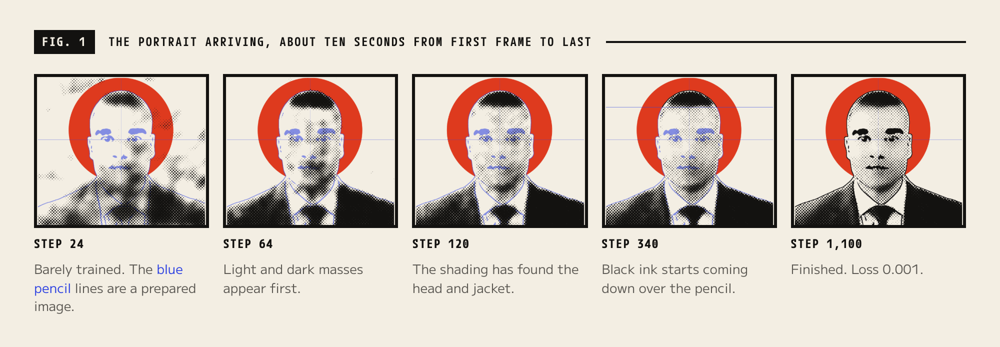
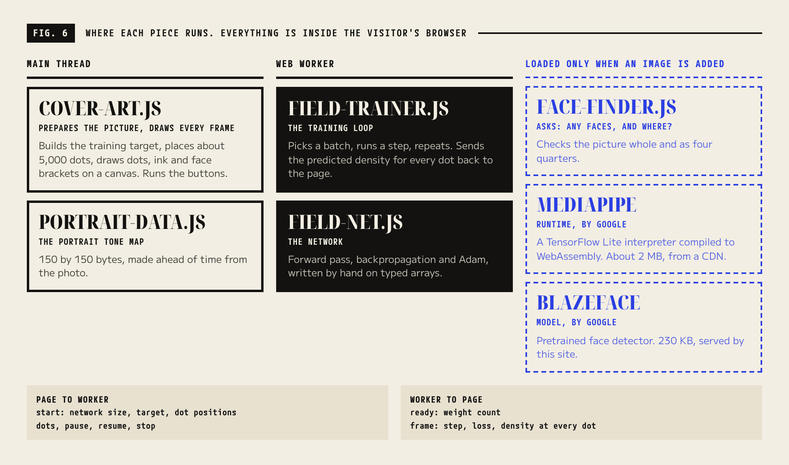
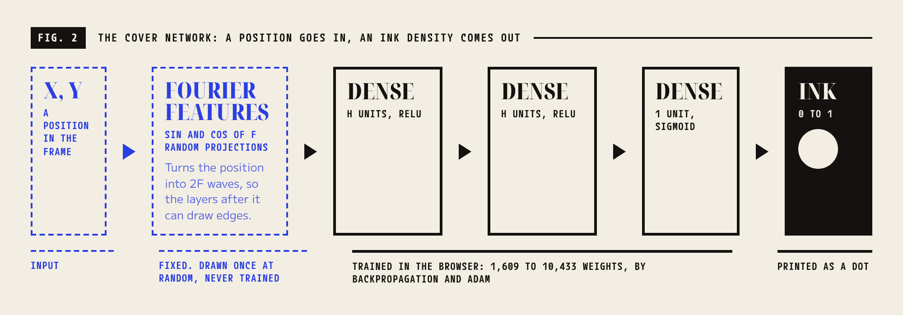
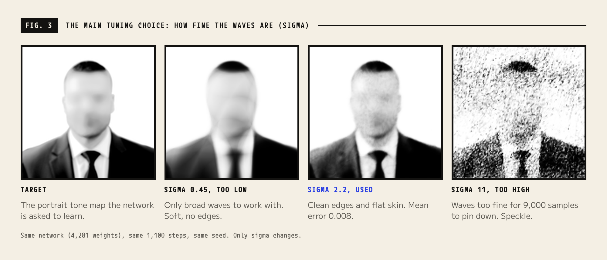
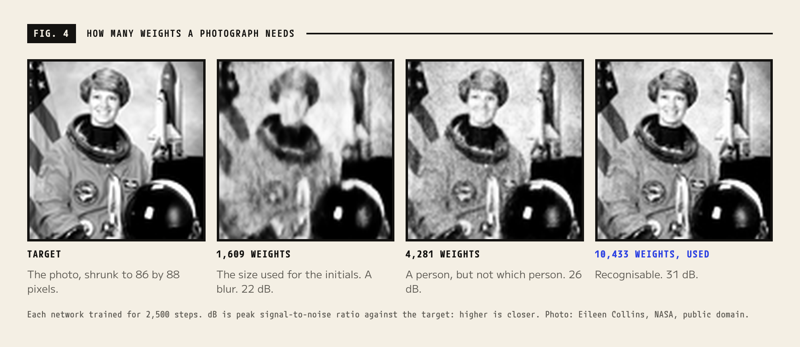
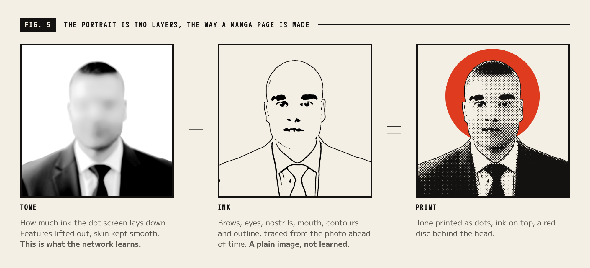
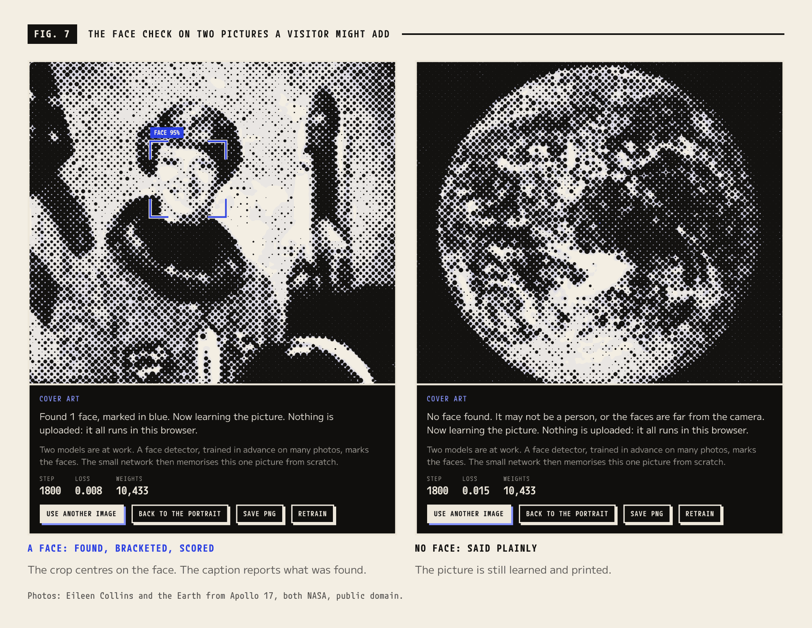

# A neural network that draws a portrait, in your browser

*How the machine learning on this site works: what runs, where it runs, how it was built, and where BlazeFace and MediaPipe fit in.*


Open the site and a portrait draws itself in about ten seconds. Blue pencil lines first, then a haze of dots that sharpens into shading, then black ink.

The dots are not a video or a prepared animation. A small neural network starts from random numbers and learns the shading of that portrait while you watch, on your own device. Add a picture of your own and it will find the faces in it, then learn that picture instead.

There is no server behind any of this. The site is static HTML, CSS and JavaScript, so everything described here happens inside the visitor's browser.

## The short version

- **Two models run on the page**, and they are very different things. One was written for this site and is trained from scratch on every visit. The other is a pretrained face detector from Google.
- **The site's own network learns one function:** give it a position in the frame, and it returns how dark the print should be there. It memorises a single picture. It does not recognise anything.
- **It is small.** Between 1,609 and 10,433 weights, in 242 lines of plain JavaScript with no ML library.
- **Training runs in a Web Worker**, so the page stays smooth while it learns.
- **The face detector is BlazeFace**, run with MediaPipe's WebAssembly runtime. It is downloaded only if a visitor adds an image.
- **A visitor's image never leaves their device.**

## Contents

1. [What you see](#1-what-you-see)
2. [Two models, two different jobs](#2-two-models-two-different-jobs)
3. [The cover network](#3-the-cover-network)
4. [Training it in the browser](#4-training-it-in-the-browser)
5. [Printing the result as halftone](#5-printing-the-result-as-halftone)
6. [The portrait: ink and tone](#6-the-portrait-ink-and-tone)
7. [A visitor's own image](#7-a-visitors-own-image)
8. [Face detection with BlazeFace and MediaPipe](#8-face-detection-with-blazeface-and-mediapipe)
9. [Privacy and what is downloaded](#9-privacy-and-what-is-downloaded)
10. [How it was built, and what was tried](#10-how-it-was-built-and-what-was-tried)
11. [Limits](#11-limits)
12. [File map](#12-file-map)
13. [The other demo: vector search](#13-the-other-demo-vector-search)
14. [References](#14-references)

---

## 1. What you see

The cover has a framed print on its right-hand side. Under it, three numbers update as training runs: the step count, the loss, and the number of weights in the network.



Three pictures can appear in the frame:

| Picture | How to get it | What is learned live |
| --- | --- | --- |
| **The portrait** | It is the default | The shading. The ink lines are a prepared image |
| **The initials** | "Draw the initials" | Everything: the letters L and J in bold dots |
| **Your own image** | "Use your own image", or drop a file on the frame | Everything, after a face check |

## 2. Two models, two different jobs

When a visitor adds an image, two models run one after the other. They are easy to confuse, so here they are side by side.

| | The cover network | The face detector |
| --- | --- | --- |
| **Its job** | Learn one picture and print it as dots | Say where the faces are in a picture |
| **Where its weights come from** | Random numbers. Trained in the page, every visit | Trained in advance by Google on a large set of photos |
| **Size** | 1,609 to 10,433 weights | A 230 KB model file |
| **Written for this site** | Yes, all of it | No. BlazeFace model, MediaPipe runtime |
| **Handles a picture it has never seen** | No. It knows only the one it was trained on | Yes. That is what it is for |

> **What the site does not do.** It does not recognise or match anyone. The detector answers "is there a face here, and where". It never answers "whose face is this". Face matching is the subject of Chapter 01 on the site, where it is described, not run.



## 3. The cover network

**Source:** [`js/field-net.js`](../js/field-net.js). 242 lines, no dependencies.

### One function

```text
f(x, y)  ->  ink density, between 0 and 1
```

Give the network a position in the frame and it returns how dark the print should be there. Once training starts, the picture is not stored anywhere as pixels. It is stored in the weights. This kind of model is called a coordinate network, or an implicit neural representation.

The honest word for what it does is *memorise*. It is trained on one picture and can reproduce only that picture. The cover says so in plain words: "It memorises this one picture. It does not recognise what is in it."



Positions run from -1 to 1 down the frame, and from -aspect to +aspect across it, so one unit is the same distance in both directions.

### Why the position is turned into waves first

A plain network fed raw (x, y) learns smooth blobs and struggles with edges. This is called spectral bias: such networks fit slow changes first and sharp ones very slowly.

The fix is to hand the network the position already expressed as waves. A matrix B with F rows is drawn once at random, with standard deviation sigma. Each position p becomes 2F numbers:

```text
[ sin(2 pi B p), cos(2 pi B p) ]
```

B is never trained. Only the three dense layers after it are.

Sigma sets how fine the waves are, and choosing it is the main tuning decision. Too low and the network can only draw soft shapes. Too high and it has more freedom than the training data can pin down, which shows up as speckle.



### Three sizes

Each picture type gets its own network:

| Picture | Projections F | Hidden units H | Sigma | Weights | Steps | Batch |
| --- | --- | --- | --- | --- | --- | --- |
| Initials | 20 | 24 | 2.0 | **1,609** | 900 | 192 |
| Portrait shading | 32 | 40 | 2.2 | **4,281** | 1,100 | 256 |
| A visitor's image | 48 | 64 | 6.0 | **10,433** | 1,800 | 256 |

The weight count is `H x 2F + H + H x H + H + H + 1`. For the portrait that is 2,560 + 40 + 1,600 + 40 + 40 + 1 = 4,281, the number shown on the cover.

Two letters need very little. The portrait's shading is smooth by design (section 6), so a mid-sized network with low frequencies fits it cleanly. A photograph has texture and needs far more.



### Written by hand

There is no ML library on the page. The file contains:

- a seeded random number generator and a normal sampler, so a given seed always draws the same picture
- He initialisation for the ReLU layers
- the forward pass
- backpropagation, derived and written out layer by layer
- the Adam optimiser (beta1 0.9, beta2 0.999)

All the weights live in one flat `Float32Array`, with an offset for each layer. The gradient and Adam's two moment buffers are arrays of the same shape. The loops are plain `for` loops over typed arrays, which is about as fast as JavaScript gets on a CPU without WebAssembly or WebGL.

### The loss

Binary cross-entropy between predicted and target density, averaged over the batch. It is computed in the logit form, which stays stable when a prediction is very close to 0 or 1:

```text
loss = max(z, 0) - z * t + log(1 + exp(-|z|))        z: output before the sigmoid, t: target
```

One detail about the number on the cover. Targets are soft (a spot can be 40% ink), and cross-entropy against a soft target can never reach zero. Its floor is the entropy of the target. The trainer subtracts that floor before reporting, so the displayed loss falls towards zero as the fit improves, whatever the picture.

## 4. Training it in the browser

**Source:** [`js/field-trainer.js`](../js/field-trainer.js).

### The training data

The target picture is turned into a small greyscale bitmap, 88 rows high for the initials and 96 for the others. That is roughly 9,000 samples, each one a position and the ink density wanted there.

Every position is turned into waves once, up front. Those encodings do not change, so there is no reason to recompute them. Each training step then:

1. picks a random batch of 192 or 256 samples
2. runs them forward
3. backpropagates the error
4. applies one Adam update

### Off the main thread

Training the largest network flat out would freeze the page, so training runs in a Web Worker.

A worker normally needs its own script file. That fails when the site is opened straight from disk, where browsers refuse to load worker scripts. So the worker is built from functions already loaded on the page:

```js
var source = '(' + LJ.defineFieldNet.toString() + ')(self);\n(' + trainerMain.toString() + ')(self);';
var url = URL.createObjectURL(new Blob([source], { type: 'text/javascript' }));
var worker = new Worker(url);
```

`field-net.js` wraps everything in one named function for exactly this reason. The network is written once and runs in both places. If a worker cannot be created at all, the same trainer runs inline behind the same interface.

### What passes between page and worker

| Direction | Message | Carries |
| --- | --- | --- |
| Page to worker | `start` | Network size, batch, steps, pace, the training target, the dot positions |
| | `dots` | New dot positions, after the frame is resized |
| | `pause`, `resume`, `stop` | |
| Worker to page | `ready` | The weight count |
| | `frame` | Step, loss, and the predicted density at every dot |

A frame is one `Float32Array` of about 5,000 values. It is handed over as a transferable, so it is moved between threads, not copied.

### Pacing

- **The initials and the portrait** train at a deliberately slow tempo at first, then speed up. A fast machine would otherwise finish before the visitor had seen anything happen.
- **A visitor's image** trains as fast as the device allows, in bursts of about 100 ms with a fresh print after each. It takes roughly 20 seconds on a laptop.
- **The learning rate falls as training goes on**, in a straight line to 10% or 15% of where it started. Large steps find the picture quickly. Small steps at the end settle the flat areas, which otherwise stay speckled.

### Good manners

- Training pauses when the cover is scrolled out of view.
- With reduced motion switched on, training runs quietly and the finished print appears once.
- When the frame is resized without changing shape, the trained network is kept.
- With JavaScript off, a static image of the finished portrait is shown.

## 5. Printing the result as halftone

**Source:** [`js/cover-art.js`](../js/cover-art.js).

The network's output is not shown as pixels. It is printed the way a manga page is: as a screen of dots, where a darker tone is a bigger dot.

- The dots sit on a lattice turned 45 degrees, the classic screentone angle.
- The lattice has about 5,000 points. The network is asked for the density at each one.
- Dot radius is `r_max x sqrt((v - 0.09) / 0.91)`. The square root makes the dot's *area* proportional to the density, which is what the eye reads as tone.
- Anything under 0.09 prints as bare paper, which keeps stray specks off areas that should be white.
- The initials use bold dots, 9 px apart. Faces get a finer screen, about 82 dots across, so the features hold together.

Hovering the frame shows a loupe and a readout of the density at that spot.

The frame always prints black ink on cream paper, in both the day and night editions of the site. A halftone face only reads one way round. Inverted, it looks like a photographic negative.

## 6. The portrait: ink and tone

A network of a few thousand weights can learn where a face is light and dark. It cannot hold the thin, sharp shapes that make a face recognisable: the line of an eyelid, the edge of a nostril. Early versions that asked the network for the whole portrait came out soft and blotchy.

So the portrait is split into two layers, the way a manga page is made.



The caption on the cover states this split, so nobody is misled about what the network did: "The lines are traced from a photo of me. The dots are a small neural network working out the shading."

### Preparing the two layers

This happens once, ahead of time, on a Mac. Two Python scripts do it. They live in the workspace's shared `execution/` folder, outside this repository.

**`make_person_matte.py`** uses the Vision framework that ships with macOS. Nothing is installed and the photo stays on the machine. It writes:

- a matte: white where the person is, black for the background
- face landmarks: points along the brows, eyes, nose, lips and jaw

**`mangafy_portrait.py`** uses only the Pillow imaging library:

1. **Crop** to head and shoulders, found from the shape of the matte.
2. **Convert to grey with red weighted up.** Skin reflects much more red than hair, brows or stubble, so this separates a face from its features. It is the same idea as a red filter on black-and-white film.
3. **Make the tone map.** The features are lifted out and filled with the surrounding skin tone, so the dots under the ink are clean. On the face, only the broad modelling of light and shadow is kept. A curve then maps brightness to ink: highlights stay bare paper, skin takes a light screen, dark cloth a heavy one, and only the darkest areas print solid.
4. **Ink the features.** Inside each landmark region, a morphological filter (a black top-hat) finds the dark marks narrower than its window. Each feature gets its own threshold, so an eye in shadow is drawn as fully as the one in the light.
5. **Ink the contours.** A difference of Gaussians on a smoothed copy gives thin lines along firm edges. On the skin of the face only the features from step 4 are kept, so the cheeks stay clean.
6. **Ink the outline.** The edge of the matte becomes one firm line round the figure.

The ink and the figure cut-out are saved as PNGs. The tone map is saved as 150 x 150 bytes in [`js/portrait-data.js`](../js/portrait-data.js), along with a few measurements such as where the face is and where the red disc goes.

### On the page

1. The red disc, the figure and the ink in blue pencil are drawn straight away.
2. The network trains on the tone map. Dots appear and sharpen.
3. As training proceeds, the black ink comes down the frame in ten held steps, replacing the pencil.

## 7. A visitor's own image

| Step | What happens |
| --- | --- |
| **1. Read** | The file is decoded in the page. It is never uploaded |
| **2. Shrink** | A working copy at most 640 px on its long side is kept. The original is released |
| **3. Find faces** | The working copy goes to the face detector (section 8) |
| **4. Crop** | The picture is fitted to the frame, centred on the faces if any were found |
| **5. Build the target** | The crop is reduced to 96 rows of brightness, with contrast stretched so a dim photo still prints with real blacks |
| **6. Train** | The largest network, 10,433 weights, learns the target |
| **7. Mark** | Each face gets a blue bracket and a score, such as "FACE 95%" |
| **8. Save** | When training ends, "Save PNG" exports the print |

The face check gets up to six seconds, since its first run has a download to make. If it takes longer, or fails, training starts without it and any faces are marked when the answer arrives.

## 8. Face detection with BlazeFace and MediaPipe

**Source:** [`js/face-finder.js`](../js/face-finder.js). 127 lines, exposing one function:

```js
LJ.findFaces(canvas)   // -> Promise of [{ x, y, w, h, score }, ...]
```



### Two pieces, both from Google

**BlazeFace is the model.** It is a small convolutional network published in 2019, designed to find faces on phones in under a millisecond per frame. It is a single-shot detector: one pass over the image produces candidate boxes with scores, and overlapping candidates are merged. The version used here is the short-range one, built for faces fairly close to the camera. It looks at a 128 x 128 copy of whatever it is given.

**MediaPipe is the runtime.** BlazeFace is distributed as a TensorFlow Lite file, which a browser cannot run by itself. MediaPipe's Tasks Vision package supplies a TensorFlow Lite interpreter compiled to WebAssembly, plus the processing around the model: resizing the input, decoding the boxes, merging overlaps.

Both are open source under the Apache License 2.0, and the site credits them in its contact section.

### Loaded only when needed

Nothing is fetched until a visitor adds an image. Someone who only reads the page pays nothing for this feature.

| Piece | Comes from | Size |
| --- | --- | --- |
| MediaPipe Tasks Vision 0.10.14 | The jsDelivr CDN, version pinned | About 2 MB over the wire |
| BlazeFace, short range, float16 | This site: [`js/face-model-data.js`](../js/face-model-data.js) | 230 KB model, 307 KB as base64 |

The model is the unmodified `.tflite` file, base64-encoded inside a script. A plain `fetch` of a binary file fails when the site is opened from disk. A script tag does not. The bytes are decoded and handed to MediaPipe as a buffer:

```js
vision.FaceDetector.createFromOptions(files, {
  baseOptions: { modelAssetBuffer: modelBytes(), delegate: 'CPU' },
  runningMode: 'IMAGE',
  minDetectionConfidence: 0.5
});
```

Once loaded, a detection takes 30 to 50 ms on a laptop. The first takes a few hundred milliseconds more while the runtime starts.

### Looking more than once

Because the model works on a 128 x 128 copy, a face that is small in the frame can be shrunk to nothing. So the picture is checked five times:

- once whole, accepting scores of 0.5 and up
- as four overlapping quarters, each 62% of the width and height, accepting scores of 0.7 and up

A face seen in more than one view is kept once, at its highest score.

### Sure rather than thorough

This is a deliberate trade. Cutting the picture into finer tiles does find the small faces of a distant crowd. In testing it also began to report faces in a photo of a cat and in a mountain landscape. For a feature whose whole point is to say "this is a person" or "this is not", a false face is the worse mistake, so the coarse scan stayed.

| Test picture | Result |
| --- | --- |
| Four single portraits | 1 face each, scores 0.81 to 0.98 |
| Four people in one picture | 4 faces, scores 0.89 to 0.93 |
| A cat, a dog, a mountain landscape, the Earth | No face |
| A group photo of 29 people, each face about 20 px | No face. Missed, by the trade above |

### What the result is used for

Three things: the brackets and scores drawn on the print, the sentence in the caption, and the choice of crop. The boxes do not feed the cover network, which learns the picture the same way with or without them.

## 9. Privacy and what is downloaded

- **A visitor's image stays on their device.** It is read from disk into the page's memory. It is not uploaded, stored or logged, and there is nowhere to upload it to.
- **Adding an image causes one outside request:** the MediaPipe runtime, from the jsDelivr CDN. That request carries no image data. The CDN sees only that a browser asked for a public JavaScript package.
- **The saved PNG** is generated in the page and handed to the browser's download mechanism.
- **No analytics, no cookies.** The site stores one value in the browser: the reader's choice of day or night edition.

## 10. How it was built, and what was tried

In the order it happened.

### The network first, tested outside the browser

`field-net.js` touches nothing in the page, so it also runs under Node. Before any page existed it was checked two ways.

- **Gradient check.** The hand-written backpropagation was compared with numerical differentiation, weight by weight. The largest difference was about 1e-8. An early run reported a mismatch that turned out to be the test's fault: with biases at zero, some ReLU units sat exactly on their kink, where a numerical slope is not defined. Randomising the biases in the test removed it.
- **Convergence.** It was trained on a synthetic monogram across a grid of sizes, sigmas and learning rates, with the result printed as ASCII art. The shape was recognisable by about step 120.

### The initials on the cover

The first version trained on the main thread, a few steps per animation frame. That was fine for 1,609 weights.

### Visitors' images

A photograph through the 1,609-weight network came out as a blur (the second panel of the network-size figure in section 3). Sizes were compared on two public-domain portraits:

| Network | Weights | Fit after 2,500 steps |
| --- | --- | --- |
| 20 projections, 24 hidden | 1,609 | 22 to 25 dB |
| 32 projections, 40 hidden | 4,281 | 26 to 28 dB |
| 48 projections, 64 hidden | 10,433 | 31 to 34 dB |

The largest was the first to give a face you would recognise. It also took about 6 ms per step, far too slow for the main thread. That is what moved training into a Web Worker.

### The portrait

The first attempt printed a photo of the site's owner through the same path as any visitor's image. It was recognisable, but it looked like a filter, not a drawing. The ink and tone split came from that. Getting the ink right took several rounds:

- Edge detection alone drew stubble and skin texture as scribble.
- Thresholding dark areas alone turned the shaded side of the face into a black patch.
- Drawing the features from the face landmarks gave clean shapes that no longer looked like the person.
- The version that worked uses the landmarks only to say *where* a feature is, and takes its *shape* from the photo.

### Tuning the shading network

With the ink carrying the detail, the tone map could be smooth, and a smaller network with a lower sigma fitted it better than the big one. Sigma and the falling learning rate were compared by measuring the error on skin specifically. The falling learning rate cut it from 0.026 to 0.018.

### Face detection

Added last. The tiling experiment in section 8 was the main piece of work.

### Checks along the way

Every change was looked at in a real browser driven by a script:

- frame timing during training, which stayed at 16.7 ms, so the worker does keep the page smooth
- each mode of the cover, plus a file that is not an image
- reduced motion, and JavaScript switched off
- the page opened from disk as well as over HTTP

## 11. Limits

- **The cover network memorises.** It generalises to nothing. Give it a new picture and it starts again from random weights.
- **Detail is capped.** The target is about 96 rows high and the network is small. Fine texture and small text in a visitor's image will not survive.
- **Every device trains its own.** A slow phone takes longer on a visitor's image. The portrait and initials are paced, so they look the same everywhere.
- **The face detector finds faces, not people.** Someone photographed from behind is "no face".
- **It misses small and distant faces**, by the choice explained in section 8.
- **It can be wrong.** A score is the model's confidence, not a guarantee. Drawings, statues and some animals can score as faces.
- **It needs a connection the first time** an image is added, to fetch the runtime. Without one, the picture is still learned and no face result is shown.
- **Tested in Chrome only.** Everything here is standard web platform, but Safari and Firefox have not been checked.

## 12. File map

| File | Role |
| --- | --- |
| [`js/field-net.js`](../js/field-net.js) | The network: Fourier features, layers, backpropagation, Adam |
| [`js/field-trainer.js`](../js/field-trainer.js) | Runs training in a Web Worker and reports frames |
| [`js/cover-art.js`](../js/cover-art.js) | Targets, halftone drawing, the three pictures, the controls |
| [`js/portrait-data.js`](../js/portrait-data.js) | Generated. The portrait's tone map and measurements |
| [`js/face-finder.js`](../js/face-finder.js) | Loads MediaPipe and BlazeFace, returns face boxes |
| [`js/face-model-data.js`](../js/face-model-data.js) | The BlazeFace model file, base64-encoded |
| `assets/img/portrait-ink.png` | Generated. The portrait's ink layer |
| `assets/img/portrait-figure.png` | Generated. The figure cut-out |
| `assets/img/portrait.png` | Generated. The finished print, shown when JavaScript is off |

To change the portrait, run the two scripts from section 6 on a new photo. They rewrite `portrait-data.js` and the three PNGs.

## 13. The other demo: vector search

Chapter 01 of the site has a second live demo, and it is worth being clear that it is **not** a neural network.

[`js/hnsw.js`](../js/hnsw.js) implements HNSW (Hierarchical Navigable Small World), the index that pgvector uses for nearest-neighbour search. [`js/index-demo.js`](../js/index-demo.js) builds an index of 560 two-dimensional points in the page, runs a real search for the five nearest to wherever the visitor clicks, and replays every step. Each search is then checked against a full scan, and the page reports how many of the five it got right.

In the real Plandaro pipeline the points are face embeddings produced by InsightFace, with hundreds of dimensions. On this site they are made-up points in two dimensions, and the demo says so. No embedding model runs in the browser.

## 14. References

- Tancik et al., *Fourier Features Let Networks Learn High Frequency Functions in Low Dimensional Domains*, 2020. The reason for the sin and cos encoding.
- Kingma and Ba, *Adam: A Method for Stochastic Optimization*, 2014.
- Bazarevsky et al., *BlazeFace: Sub-millisecond Neural Face Detection on Mobile GPUs*, 2019.
- MediaPipe Face Detector guide: <https://ai.google.dev/edge/mediapipe/solutions/vision/face_detector>
- Malkov and Yashunin, *Efficient and Robust Approximate Nearest Neighbor Search Using Hierarchical Navigable Small World Graphs*, 2016.

---

*Figures 1 and 7 are screenshots of the live site. Figures 3 and 4 were produced by running `field-net.js` under Node. The astronaut portrait and the photo of the Earth are NASA images in the public domain.*
