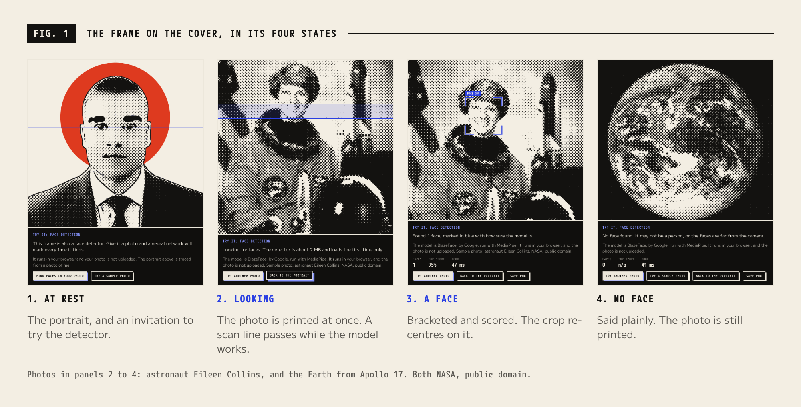
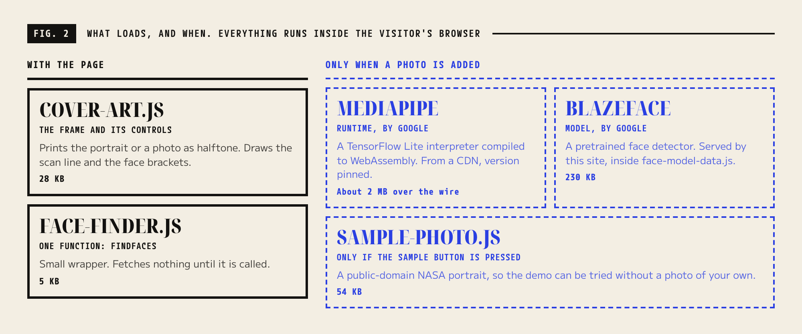
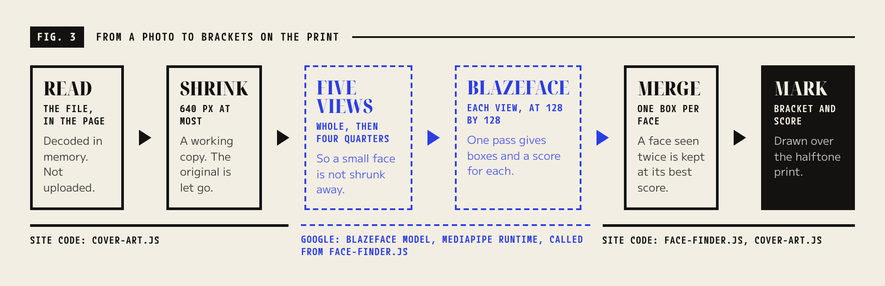
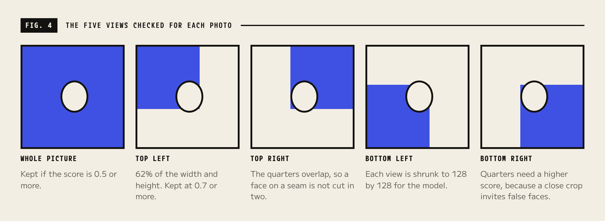

# I put a neural network on a static website. It runs entirely in your browser.

My portfolio site has no server. It is plain HTML, CSS and JavaScript on static hosting.

It also has a working face detector on the front page. Give it a photo and a neural network marks every face in about a twentieth of a second. The photo never leaves your device.

I still find it a little amazing that this works at all. Here is why it does, how I put it together, and what I would do the same way again.

## What it does

The framed portrait on the cover doubles as the demo. You can add a photo of your own or press "Try a sample photo". A scan line passes down the picture, then each face gets a blue bracket and a confidence score. If there is no face, it says so.

It finds faces. It does not recognise who anyone is.

## Why I built it

At Plandaro I work on a face recognition pipeline that matches guests across thousands of event photos. That runs on servers, as it should.

For my own site I wanted the opposite: something a visitor could try in a few seconds, with nothing to install and nothing uploaded.

## Why a neural network can run in a browser at all

It sounds like it should need a server. It does not, for four reasons.

**1. Running a model is only arithmetic.** A trained network is a fixed list of numbers. Using it means multiplying arrays, adding, and repeating that layer by layer. Any device that can do arithmetic can do it.

**2. The expensive part was done in advance.** Training is what takes large computers and large datasets. Your browser only runs the finished model, once per photo.

**3. The model is tiny.** The one I used is 230 KB, smaller than most photos. The models behind chat assistants are measured in gigabytes, which is why those still run on servers.

**4. WebAssembly makes it fast.** The runtime is compiled code, not plain JavaScript, and the model looks at a picture of only 128 by 128 pixels.

## What I used, and what I wrote

I did not train the model, and I want to be clear about that.

- **The model is BlazeFace**, a small face detector published by Google.
- **The runtime is MediaPipe**, also from Google, which runs the model in the browser through WebAssembly.

My code is everything around them. The first decision was to load nothing until someone asks for it. The model and runtime are about 2.3 MB together, and a visitor who only reads the page should not pay for a feature they never use.

After that, the path from a photo to brackets has six steps.

## The decision I am happiest with

The model works on a small copy of whatever you give it, so a face that is small in the photo can be shrunk away to nothing. My fix was to check each photo five times: once whole, then as four overlapping quarters.

The obvious next step was to cut the photo into even finer tiles. I tried it. It did find the small faces in a group photo of 29 people.

It also started finding faces in a photo of a cat, and in a mountain landscape.

For a demo whose whole point is to say "this is a person" or "this is not", a false face is the worse mistake. So I kept the coarse scan, and the page is honest about the cost: when it finds nothing, it says the faces may simply be too far from the camera.

## Three things I learned

**Machine learning does not have to mean a server.** This is the part that surprised me most. No backend, no GPU, no API key. A static page and a 230 KB file are enough to run a real neural network. If a model is small enough to download, the visitor's own device can do the work.

**The browser is a serious place to run code.** The runtime here is compiled C++ running as WebAssembly, and one detection takes about a twentieth of a second on a laptop. Training is possible too. An earlier version of this page trained a small network from scratch, in plain JavaScript, in about ten seconds while you watched. I took it out to keep the page focused, but it worked.

**Private by design beats private by policy.** The photo never leaves your device because there is nowhere to send it. There is no upload to secure and nothing to store. It also costs nothing to run, however many people try it.

## So should everything run in the browser?

No. The model has to be small enough to download, and its speed depends on the visitor's device.

A server can run a model as large as it needs and search a database. The price is that the photo has to be uploaded and every request costs money.

Checking one photo for faces suits the browser. Matching one face against thousands of stored photos does not, which is why the pipeline I work on at Plandaro lives on servers.

## Try it

The demo is on the front page of my site: https://416lj.github.io/

The full write-up, with the diagrams above and the limits I have not covered here, is in the README of the repository: https://github.com/416LJ/416lj.github.io
